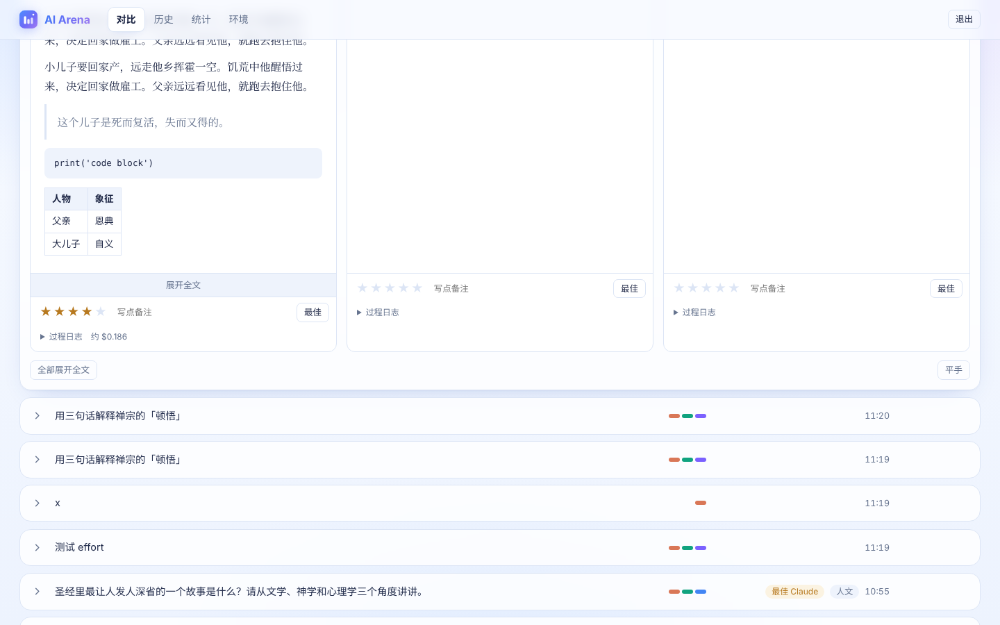

# AI Arena

同一个问题同时发给 **Claude Code**、**Codex** 和 **Antigravity CLI**，三列并排流式显示，可以打分、评「最佳」，并长期积累统计，看出不同模型在不同类型问题上的差异。

本地运行，单个 Python 文件，只用标准库。



## 功能

- **三列并排、流式输出**：每列显示实际使用的模型、用时、状态，支持 Markdown 排版和原文切换
- **模型与 Effort 选择**：每个工具都可以选模型和 effort（思考投入程度），选择会被记住
- **阅读模式**：长回答可以「展开全文」，或打开宽屏阅读窗口，用 ← → 在三个模型间切换
- **对比流**：每轮对比可折叠，标题上的三色进度条一眼看出各工具结果
- **打分与统计**：1–5 星、备注、最佳/平手；统计页按工具，或按工具、模型和 effort 汇总平均分、胜率、耗时
- **历史**：搜索、按标签筛选、重跑
- **环境页**：检测三个 CLI 是否安装，一键安装（装到 `~/.ai-arena`，不需要管理员权限）并打开终端登录
- **macOS App**：双击启动，空闲 15 分钟自动退出；跟随系统亮色 / 暗色

## 使用

需要 Python 3.8+ 和 macOS（Linux 也能运行网页部分）。

```bash
git clone https://github.com/alanshen1/AI-Arena.git
cd AI-Arena
python3 arena.py          # 打开 http://127.0.0.1:8765
```

或者双击 `macos/AI Arena.app`。第一次如果 macOS 提示无法打开，右键选「打开」确认一次即可。

第一次使用：进入「环境」页，对没找到的工具点「一键安装」，再点「登录」在弹出的终端里登录一次。

| 工具 | 命令 | 登录方式 |
|---|---|---|
| Claude Code | `claude -p` | Claude 账号 |
| Codex | `codex exec` | ChatGPT 账号 |
| Antigravity CLI | `agy -p` | Google 账号 |

> Gemini CLI 自 2026-06-18 起不再支持个人账号，已由 Antigravity CLI 取代。配置里保留了 Gemini（默认停用），有付费 Gemini API key 时可以重新启用。

## 文件

| 文件 | 说明 |
|---|---|
| `arena.py` | 后端（HTTP + SSE 流式 + SQLite），内置一份网页 |
| `arena.html` | 网页界面；放在 `arena.py` 旁边时优先使用，方便单独修改 |
| `macos/AI Arena.app` | macOS 启动器 |

首次运行会生成（已在 `.gitignore` 中排除）：

- `arena_config.json`：各工具的命令、模型列表、effort 参数，可自行修改或加入新工具
- `arena.db`：历史、评分（SQLite）
- `arena.log`：App 启动日志

## 配置示例

```json
"claude": {
  "cmd": ["claude", "-p", "{prompt}", "--output-format", "stream-json", "--verbose", "--include-partial-messages"],
  "parser": "claude_stream",
  "model_flag": "--model",
  "effort_args": ["--effort", "{effort}"],
  "efforts": ["low", "medium", "high", "xhigh", "max"]
}
```

- `pty: true`：用伪终端运行（Antigravity CLI 在非终端环境下可能卡住）
- `models_cmd`：动态读取可用模型（如 `agy models`）
- `enabled: false`：停用某个工具

## 安全

- 只监听 `127.0.0.1`，每次启动生成随机 token，并校验 Host 头，防止其他网页调用本地接口
- 模型输出经 DOMPurify 清理后再渲染
- 填写「工作目录」时，CLI 可能真的修改其中的文件，对比改代码类问题时建议指向一份拷贝

## 第三方

网页内嵌 [marked](https://github.com/markedjs/marked)（MIT）和 [DOMPurify](https://github.com/cure53/DOMPurify)（Apache-2.0 / MPL-2.0），离线也能正常排版。
