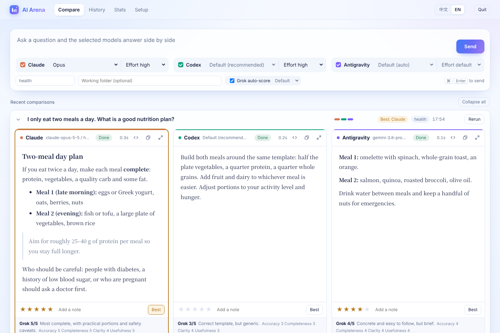
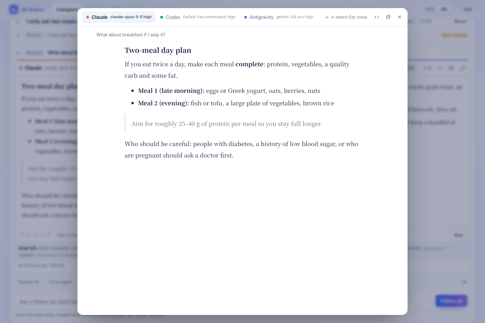
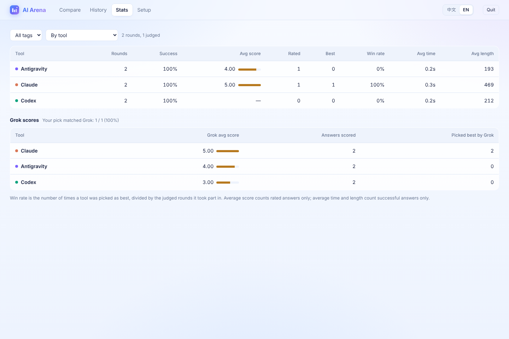
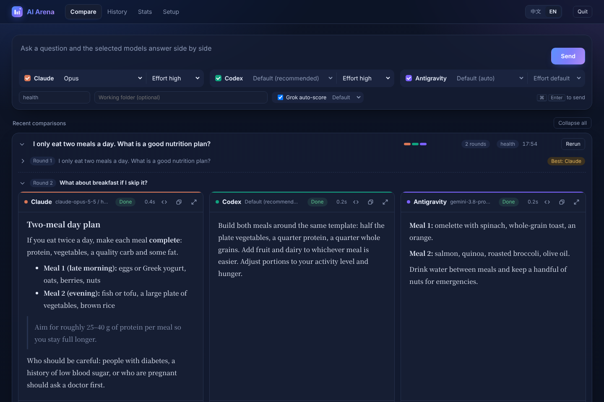

# AI Arena

Send one question to **Claude Code**, **Codex** and **Antigravity CLI** at the same time and read their answers side by side. Rate them, follow up, let **Grok** score them anonymously, and build up your own statistics on which model does best at what.

AI Arena runs locally as a single Python file with no dependencies beyond the standard library. The interface is available in English and Chinese.



## Features

- **Side-by-side streaming**: answers stream into three columns, each showing the model actually used, elapsed time and status. Switch between formatted Markdown and raw text.
- **Chat mode** (on by default): all three tools are coding agents whose built-in instructions favor short answers. Chat mode adds the same instruction to every tool, asking it to answer like a general-purpose assistant with a complete, structured answer. Your question is stored as typed, and follow-ups keep the setting.
- **Attachments**: click the paperclip, drag files onto the question box, or paste them, to attach Word, Excel, PowerPoint, PDF, CSV, text or image files (up to 50 MB each), on the first question or a follow-up. AI Arena extracts the text and sends the same content to every tool, so the comparison stays fair. It also gives each tool the path of the original file so it can open images, charts or layout itself. Attachments show on each round and open with a click; **Rerun** reuses them, and Grok sees the same text when scoring. See [Attachments](#attachments).
- **Model and effort per tool**: pick a model and an effort level for each tool. Your choices are remembered.
- **Follow-up questions**: ask a follow-up under any round and each tool continues its own session (`claude --resume`, `codex exec resume`, `agy --conversation`). If a tool has no session ID from the last round, the earlier Q&A is added before the question instead. With **Include the other answers** (on by default), each tool also gets the other models' answers from the previous round, labeled by model, so you can ask them to compare, critique or combine the answers. Turn it off when you want each tool to answer on its own; rounds that saw the other answers are marked.
- **Conversation feed**: each card is a conversation. Older rounds fold automatically, and a three-color bar on each card shows how each tool did in the latest round.
- **Reader mode**: expand long answers in place, or open a wide reading view and use ← → to switch between models.
- **Anonymous scoring by Grok**: after a round (automatically or on demand), the successful answers are shuffled, relabeled A/B/C and sent to Grok. Grok scores accuracy, completeness, clarity and usefulness and picks a best answer. Grok does not compete, which avoids a model favoring its own style. While it works, the page shows the elapsed time; scoring usually takes one to three minutes because Grok checks the facts in each answer.
- **Your ratings and stats**: give 1–5 stars, notes, and a best or tie for each round. The Stats page summarizes average score, win rate, time and length by tool, or by tool, model and effort, plus Grok's scores and how often your pick matches Grok's.
- **History**: search (including follow-ups), filter by tag, reopen or rerun.
- **Setup page**: checks whether each CLI is installed, installs missing ones into `~/.ai-arena` with one click (no admin rights needed), and opens Terminal for the one-time sign-in.
- **macOS app**: double-click to start; it quits by itself after 15 idle minutes. Light and dark mode follow your system.
- **English and Chinese**: switch languages from the top-right corner. Error messages, process logs and Grok's comments follow the selected language.


## Getting started

You need Python 3.8 or later. The app launcher is for macOS; the web interface also runs on Linux.

```bash
git clone https://github.com/alanshen1/AI-Arena.git
cd AI-Arena
python3 arena.py          # opens http://127.0.0.1:8765
```

Or double-click `macos/AI Arena.app`. If macOS says the app cannot be opened the first time, right-click it and choose **Open**.

On first use, go to the **Setup** page. For each missing tool, click **Install**, then **Sign in** and finish signing in in the Terminal window that opens.

| Tool | Command | Sign in with |
|---|---|---|
| Claude Code | `claude -p` | Claude account |
| Codex | `codex exec` | ChatGPT account |
| Antigravity CLI | `agy -p` | Google account |
| Grok CLI (scoring only) | `grok -p` | xAI / X account |

> Gemini CLI stopped supporting personal accounts on June 18, 2026 and has been replaced by Antigravity CLI. Gemini remains in the config, disabled by default; you can re-enable it if you have a paid Gemini API key.

## Updating

Pull the latest code (or replace `arena.py` and `arena.html`), then click **Quit** in the top-right corner and start AI Arena again. Reloading the page is not enough: it loads the new page but keeps the old background service running. Your config and database are migrated automatically on the next start.

## Attachments

| Format | How the text is extracted |
|---|---|
| Word `.docx`, Excel `.xlsx`/`.xlsm`, PowerPoint `.pptx` | Built in (paragraphs and tables; one section per sheet or slide; a formula is shown when a cell has no saved value) |
| PDF | `pdftotext` if installed, otherwise macOS PDFKit |
| `.doc`, `.rtf`, `.odt` | macOS `textutil` |
| Text, Markdown, CSV, JSON, code | Read directly (UTF-8, GB18030 and Shift-JIS are detected) |
| Images and other files | No text; the tools get the file path and can open it themselves |

- Each file contributes up to 60,000 characters and each question up to 100,000; longer text is cut and the tools are told where to find the rest.
- Files are copied into `attachments/<round>/` next to `arena.py` and deleted with the conversation.
- If you leave **Working folder** empty, the tools run in the attachments folder. If you set one, Claude and Antigravity also get `--add-dir` for the attachments folder; Codex can read the path in its default sandbox.
- A scanned PDF has no text layer. The tools can still open it, but only models that read images will see the content.

## Files

| File | Purpose |
|---|---|
| `arena.py` | Backend (HTTP, SSE streaming, SQLite) with a built-in copy of the web page |
| `arena.html` | Web interface; used instead of the built-in copy when it sits next to `arena.py`, so you can edit it separately |
| `macos/AI Arena.app` | macOS launcher |

Created on first run and excluded by `.gitignore`:

- `arena_config.json`: commands, model lists and effort options for each tool. Edit it or add new tools.
- `arena.db`: history, ratings and scores (SQLite).
- `arena.log`: launcher log.
- `attachments/`: files you attached, one folder per round.

## Configuration

```json
"claude": {
  "cmd": ["claude", "-p", "{prompt}", "--output-format", "stream-json", "--verbose", "--include-partial-messages"],
  "parser": "claude_stream",
  "model_flag": "--model",
  "effort_args": ["--effort", "{effort}"],
  "efforts": ["low", "medium", "high", "xhigh", "max"],
  "resume_args": ["--resume", "{session}"]
}
```

| Key | Meaning |
|---|---|
| `cmd` | Command to run; `{prompt}` is replaced by the question |
| `parser` | How to read the output: `claude_stream`, `codex_json`, `agy_stream` or `raw` |
| `model_flag` / `models` | Option used to pass the model, and the models offered in the picker |
| `effort_args` / `efforts` | Arguments used to pass effort (`{effort}` is replaced), and the levels offered |
| `resume_args` / `resume_pos` | Arguments used to continue a session for follow-ups (`{session}` is replaced) |
| `models_cmd` | Command that lists available models at runtime, e.g. `agy models` |
| `pty: true` | Run in a pseudo-terminal (Antigravity CLI can hang without a terminal) |
| `install_script` / `package` | One-click install method: a shell script, or an npm package |
| `role: "judge"` | Use this tool for scoring instead of competing (Grok by default) |
| `enabled: false` | Turn a tool off |

## Troubleshooting

| Symptom | What to do |
|---|---|
| A column says **Not installed** | Open **Setup**, click **Install**, then **Sign in**. If the tool is installed somewhere unusual, put its full path in `arena_config.json`. |
| Answers are much shorter than in the ChatGPT, Claude or Gemini apps | The CLIs are coding agents tuned for brevity, and the apps also use your personal memory. Turn on **Chat mode**. |
| Codex stays on **Generating** for a long time | Codex waits instead of failing when you are not signed in. Click **Sign in** for Codex on the Setup page. |
| An answer column is empty but marked **Done** | Open its **Process log**. If the output format was not recognized, the raw output is written there. |
| An attachment says **No text extracted** | It is an image, a scanned PDF or an unsupported format. The tools still get the file path. For a PDF on Linux, install `poppler-utils` for `pdftotext`. |
| Grok scoring takes minutes | This is normal; Grok verifies facts before it answers. To save time and quota, turn off auto-score and click **Ask Grok to score** only on rounds you care about, or pick a faster model next to the auto-score switch. |
| Scoring shows **failed** or **interrupted** | Hover over the message to see Grok's raw reply, then click **Retry scoring**. Scoring is interrupted if the background service restarts while it runs. |
| Grok scoring stops working | Grok uses your subscription's shared weekly usage pool (Grok Build, chat, images and voice combined). Paid features pause until the weekly limit resets. |
| A new feature does not appear after an update | Click **Quit** and start AI Arena again; see [Updating](#updating). |

## Privacy and safety

- The server listens on `127.0.0.1` only. Each start creates a random token, and the Host header is checked, so other web pages cannot call your local CLIs.
- Model output is sanitized with DOMPurify before it is rendered.
- Scoring hides which model wrote each answer, but an answer that names itself (for example, "As Claude…") can still give it away.
- Attachments stay on your computer, but their content is sent to every selected tool (and to Grok when scoring). Don't attach anything you would not paste into those services.
- If you set a working folder, the CLIs may change files in it. When comparing coding tasks, point it at a copy.

## Screenshots

| Reader mode | Stats | Dark mode |
|---|---|---|
|  |  |  |

## Third-party code

The web page embeds [marked](https://github.com/markedjs/marked) (MIT) and [DOMPurify](https://github.com/cure53/DOMPurify) (Apache-2.0 / MPL-2.0), so formatting works offline.
