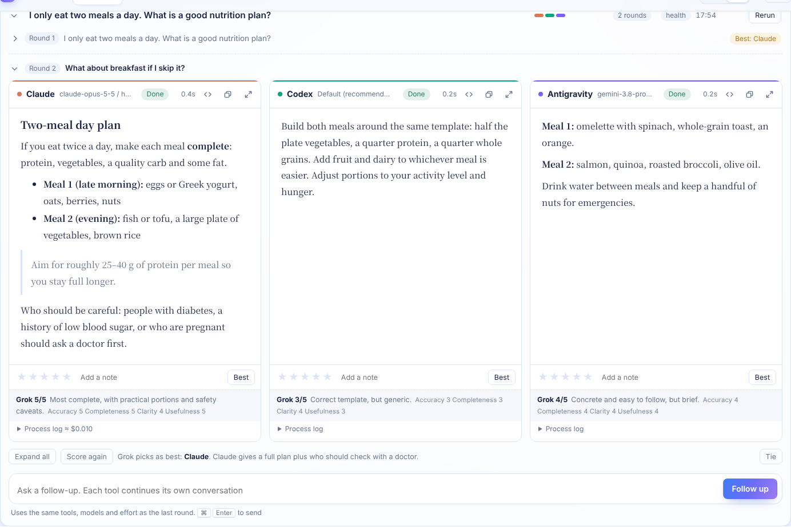

# AI Arena

Send one question to **Claude Code**, **Codex** and **Antigravity CLI** at the same time and read their answers side by side. Rate them, follow up, let **Grok** score them anonymously, and build up your own statistics on which model does best at what.

AI Arena runs locally as a single Python file with no dependencies beyond the standard library. The interface is available in English and Chinese.


## Features

- **Side-by-side streaming**: answers stream into three columns, each showing the model actually used, elapsed time and status. Switch between formatted Markdown and raw text.
- **Model and effort per tool**: pick a model and an effort level for each tool. Your choices are remembered.
- **Follow-up questions**: ask a follow-up under any round and each tool continues its own session (`claude --resume`, `codex exec resume`, `agy --conversation`). If a tool has no session ID from the last round, the earlier Q&A is added before the question instead.
- **Conversation feed**: each card is a conversation. Older rounds fold automatically, and a three-color bar on each card shows how each tool did in the latest round.
- **Reader mode**: expand long answers in place, or open a wide reading view and use ← → to switch between models.
- **Anonymous scoring by Grok**: after a round (automatically or on demand), the successful answers are shuffled, relabeled A/B/C and sent to Grok. Grok scores accuracy, completeness, clarity and usefulness and picks a best answer. Grok does not compete, which avoids a model favoring its own style.
- **Your ratings and stats**: give 1–5 stars, notes, and a best or tie for each round. The Stats page summarizes average score, win rate, time and length by tool, or by tool, model and effort, plus Grok's scores and how often your pick matches Grok's.
- **History**: search (including follow-ups), filter by tag, reopen or rerun.
- **Setup page**: checks whether each CLI is installed, installs missing ones into `~/.ai-arena` with one click (no admin rights needed), and opens Terminal for the one-time sign-in.
- **macOS app**: double-click to start; it quits by itself after 15 idle minutes. Light and dark mode follow your system.
- **English and Chinese**: switch languages from the top-right corner. Error messages, process logs and Grok's comments follow the selected language.



## Getting started

You need Python 3.8 or later. The app launcher is for macOS; the web interface also runs on Linux.

```bash
git clone https://github.com/alanshen1/AI-Arena.git
cd AI-Arena
python3 arena.py          # opens http://127.0.0.1:8765
```

Or double-click `macos/AI Arena.app`. If macOS says the app cannot be opened the first time, right-click it and choose **Open**.

On first use, go to the **Setup** page. For each missing tool, click **Install**, then **Sign in** and finish signing in in the Terminal window that opens.

| Tool | Command | Sign in with |
|---|---|---|
| Claude Code | `claude -p` | Claude account |
| Codex | `codex exec` | ChatGPT account |
| Antigravity CLI | `agy -p` | Google account |
| Grok CLI (scoring only) | `grok -p` | xAI / X account |

> Gemini CLI stopped supporting personal accounts on June 18, 2026 and has been replaced by Antigravity CLI. Gemini remains in the config, disabled by default; you can re-enable it if you have a paid Gemini API key.

## Files

| File | Purpose |
|---|---|
| `arena.py` | Backend (HTTP, SSE streaming, SQLite) with a built-in copy of the web page |
| `arena.html` | Web interface; used instead of the built-in copy when it sits next to `arena.py`, so you can edit it separately |
| `macos/AI Arena.app` | macOS launcher |

Created on first run and excluded by `.gitignore`:

- `arena_config.json`: commands, model lists and effort options for each tool. Edit it or add new tools.
- `arena.db`: history, ratings and scores (SQLite).
- `arena.log`: launcher log.

## Configuration

```json
"claude": {
  "cmd": ["claude", "-p", "{prompt}", "--output-format", "stream-json", "--verbose", "--include-partial-messages"],
  "parser": "claude_stream",
  "model_flag": "--model",
  "effort_args": ["--effort", "{effort}"],
  "efforts": ["low", "medium", "high", "xhigh", "max"],
  "resume_args": ["--resume", "{session}"]
}
```

| Key | Meaning |
|---|---|
| `cmd` | Command to run; `{prompt}` is replaced by the question |
| `parser` | How to read the output: `claude_stream`, `codex_json`, `agy_stream` or `raw` |
| `model_flag` / `models` | Option used to pass the model, and the models offered in the picker |
| `effort_args` / `efforts` | Arguments used to pass effort (`{effort}` is replaced), and the levels offered |
| `resume_args` / `resume_pos` | Arguments used to continue a session for follow-ups (`{session}` is replaced) |
| `models_cmd` | Command that lists available models at runtime, e.g. `agy models` |
| `pty: true` | Run in a pseudo-terminal (Antigravity CLI can hang without a terminal) |
| `install_script` / `package` | One-click install method: a shell script, or an npm package |
| `role: "judge"` | Use this tool for scoring instead of competing (Grok by default) |
| `enabled: false` | Turn a tool off |

## Privacy and safety

- The server listens on `127.0.0.1` only. Each start creates a random token, and the Host header is checked, so other web pages cannot call your local CLIs.
- Model output is sanitized with DOMPurify before it is rendered.
- Scoring hides which model wrote each answer, but an answer that names itself (for example, "As Claude…") can still give it away.
- If you set a working folder, the CLIs may change files in it. When comparing coding tasks, point it at a copy.

## Screenshots

| Reader mode | Stats | Dark mode |
|---|---|---|
|  |  |  |

## Third-party code

The web page embeds [marked](https://github.com/markedjs/marked) (MIT) and [DOMPurify](https://github.com/cure53/DOMPurify) (Apache-2.0 / MPL-2.0), so formatting works offline.
