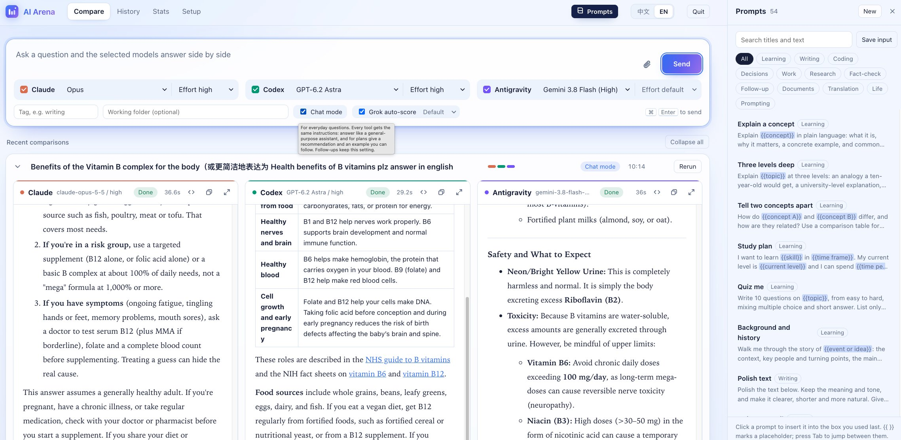
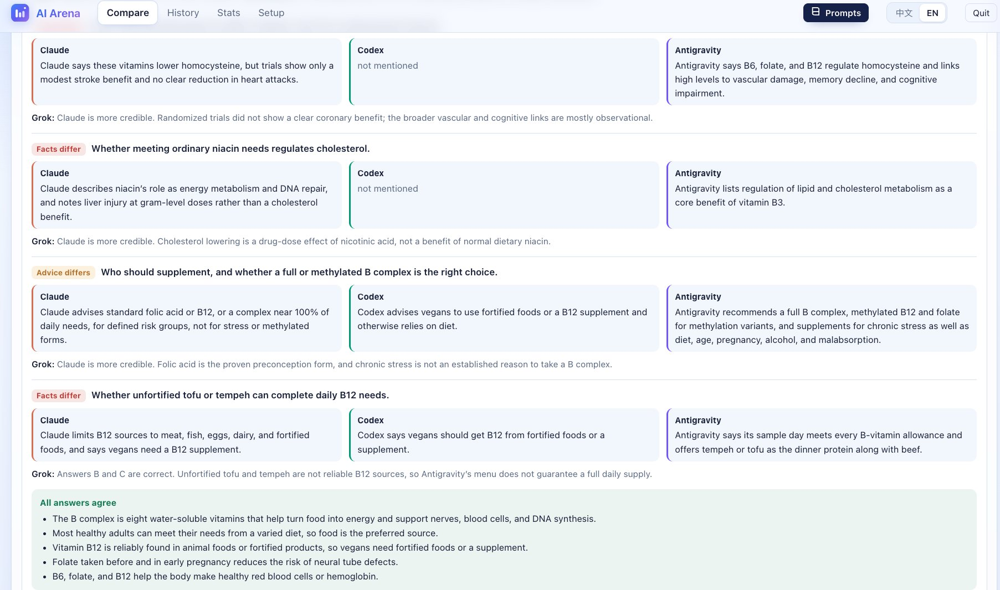

# AI Arena

Send one question to **Claude Code**, **Codex** and **Antigravity CLI** at the same time and read their answers side by side. Rate them, follow up, let **Grok** score them anonymously, and build up your own statistics on which model does best at what.

AI Arena runs locally as a single Python file with no dependencies beyond the standard library. The interface is available in English, Chinese and Japanese.


## Features

- **Side-by-side streaming**: answers stream into three columns, each showing the model actually used, elapsed time and status. Switch between formatted Markdown and raw text.
- **Chat mode** (on by default): all three tools are coding agents whose built-in instructions favor short answers. Chat mode adds the same instruction to every tool, asking it to answer like a general-purpose assistant with a complete, structured answer; for advice or a plan, it asks for a recommendation and an example you can follow. Every tool gets identical instructions, so the comparison stays fair. Your question is stored as typed, and follow-ups keep the setting.
- **Attachments**: click the paperclip, drag files onto the question box, or paste them, to attach Word, Excel, PowerPoint, PDF, CSV, text or image files (up to 50 MB each), on the first question or a follow-up. AI Arena extracts the text and sends the same content to every tool, so the comparison stays fair. It also gives each tool the path of the original file so it can open images, charts or layout itself. Attachments show on each round and open with a click; **Rerun** reuses them, and Grok sees the same text when scoring. See [Attachments](#attachments).
- **Model and effort per tool**: pick a model and an effort level for each tool. Your choices are remembered. Antigravity's list is read from `agy models` at startup, so it shows the models your Google plan includes (for example Gemini 4 Neon), and the last list is cached in `models_cache.json`.
- **Optional OpenAI GPT column**: compare GPT-6.2 Sol or Astra through the OpenAI Responses API. It is hidden unless you set `ARENA_OPENAI_API_KEY` and turn on **Show OpenAI GPT** on the Setup page. It uses separate API credits, not a ChatGPT subscription. See [OpenAI API column](#openai-api-column).
- **Follow-up questions**: ask a follow-up under any round and each tool continues its own session (`claude --resume`, `codex exec resume`, `agy --conversation`). If a tool has no session ID from the last round, the earlier Q&A is added before the question instead. With **Include the other answers** (on by default), each tool also gets the other models' answers from the previous round, labeled by model, so you can ask them to compare, critique or combine the answers. Turn it off when you want each tool to answer on its own; rounds that saw the other answers are marked.
- **Continue in the tool itself**: the arrow button on each answer opens that session outside Arena. Claude continues in **Claude Desktop** (`claude --desktop --resume`), Codex opens in the **Codex App** (`codex://threads/<id>`), and every tool can continue in **Terminal** or copy its resume command. See [Continuing a session](#continuing-a-session).
- **Prompt library**: a panel on the right (click **Prompts** in the top bar) holds reusable prompts. Click one to insert it into the question box or follow-up box you used last. It comes with 54 built-in prompts in 12 categories (learning, writing, coding, decisions, work, research, fact-checking, follow-ups, documents, translation, everyday life and prompting), shown in the interface language. Mark the parts you change each time as `{{placeholder}}`: the first one is selected after inserting, and Tab jumps to the next. Search, filter by category, pin, edit, delete, or save what you typed with **Save input**. See [Prompt library](#prompt-library).
- **Conversation feed**: each card is a conversation. Older rounds fold automatically, and a three-color bar on each card shows how each tool did in the latest round.
- **Reader mode**: expand long answers in place, or open a wide reading view and use ← → to switch between models.
- **Anonymous scoring by Grok**: after a round (automatically or on demand), the successful answers are shuffled, relabeled A/B/C and sent to Grok. Grok scores accuracy, completeness, clarity and usefulness and picks a best answer. Grok does not compete, which avoids a model favoring its own style. In the same call Grok also lists **disagreements and agreement**: each point where the answers differ (marked as conflicting facts, different advice or different emphasis), what each tool says, placed under that tool's column, and which position Grok finds more credible or how to check it, followed by the points all answers agree on. While it works, the page shows the elapsed time; scoring usually takes one to three minutes because Grok checks the facts in each answer.
- **Your ratings and stats**: give 1–5 stars, notes, and a best or tie for each round. The Stats page summarizes average score, win rate, time and length by tool, or by tool, model and effort, plus Grok's scores and how often your pick matches Grok's.
- **History**: search (including follow-ups), filter by tag, reopen or rerun.
- **Setup page**: checks whether each CLI is installed, installs missing ones into `~/.ai-arena` with one click (no admin rights needed), and opens Terminal for the one-time sign-in.
- **macOS app**: double-click to start; it quits by itself after 15 idle minutes. Light and dark mode follow your system.
- **English, Chinese and Japanese**: switch languages from the top-right corner. Everything follows the selected language: the interface, error messages and process logs, the instructions sent to the models, Grok's scoring prompt and comments, and the built-in prompts. All text lives in `locales/*.json`, so you can fix wording or add a language without touching the code. See [Languages](#languages).


## Getting started

You need Python 3.8 or later. The app launcher is for macOS; the web interface also runs on Linux.

```bash
git clone https://github.com/alanshen1/AI-Arena.git
cd AI-Arena
python3 arena.py          # opens http://127.0.0.1:8765
```

Or double-click `macos/AI Arena.app`. If macOS says the app cannot be opened the first time, right-click it and choose **Open**.

On first use, go to the **Setup** page. For each missing tool, click **Install**, then **Sign in** and finish signing in in the Terminal window that opens.

| Tool | Command | Sign in with |
|---|---|---|
| Claude Code | `claude -p` | Claude account |
| Codex | `codex exec` | ChatGPT account |
| Antigravity CLI | `agy -p` | Google account |
| Grok CLI (scoring only) | `grok -p` | xAI / X account |

> Gemini CLI stopped supporting personal accounts on June 18, 2026 and has been replaced by Antigravity CLI. Gemini remains in the config, disabled by default; you can re-enable it if you have a paid Gemini API key.

## Updating

Pull the latest code (or replace `arena.py`, `arena.html`, `arena_openai.py` and the whole `locales` folder), then click **Quit** in the top-right corner and start AI Arena again. Reloading the page is not enough: it loads the new page but keeps the old background service running. Your config and database are migrated automatically on the next start.

## Attachments

| Format | How the text is extracted |
|---|---|
| Word `.docx`, Excel `.xlsx`/`.xlsm`, PowerPoint `.pptx` | Built in (paragraphs and tables; one section per sheet or slide; a formula is shown when a cell has no saved value) |
| PDF | `pdftotext` if installed, otherwise macOS PDFKit |
| `.doc`, `.rtf`, `.odt` | macOS `textutil` |
| Text, Markdown, CSV, JSON, code | Read directly (UTF-8, GB18030 and Shift-JIS are detected) |
| Images and other files | No text; the tools get the file path and can open it themselves |

- Each file contributes up to 60,000 characters and each question up to 100,000; longer text is cut and the tools are told where to find the rest.
- Files are copied into `attachments/<round>/` next to `arena.py` and deleted with the conversation.
- The tools run in the workspace folder (`~/AI Arena` by default) or in the working folder you set, and Claude and Antigravity get `--add-dir` for the attachments folder; Codex can read the path in its default sandbox.
- A scanned PDF has no text layer. The tools can still open it, but only models that read images will see the content.

## Continuing a session

Claude Code, Codex and Antigravity keep their own history of every Arena round, but their desktop apps do not list sessions created from the command line. The arrow button on each answer (shown once it has finished) opens the session where you can keep working:

| Tool | Continue in the app | Continue in Terminal |
|---|---|---|
| Claude | Runs `claude --desktop --resume <id>`, which opens the session in the Code tab of Claude Desktop. Needs Claude Code v2.1.285 or later and a Claude subscription sign-in. | `claude --resume <id>` |
| Codex | Opens `codex://threads/<id>` in the Codex App. If the app does not show the session, use Terminal. | `codex resume <id>` |
| Antigravity | The desktop app cannot open CLI conversations. | `agy --conversation <id>` |

- **Add new conversations to Claude Desktop** (Setup page, off by default): after the first round of each new conversation, Arena runs `claude --desktop --resume` once for Claude's session, so it appears in the Claude Desktop sidebar under the workspace folder's group (**AI Arena** by default). Each session is added once; follow-ups keep using the same session. The session gets a title that sums up the question, written by a quick Claude Haiku call (not saved as a session); with the switch off, the title is the first line of the question. Claude receives chat-mode instructions through `--append-system-prompt`, so the conversation shows only your question. Claude Desktop opens the session when it is added. The result is written to Claude's process log.
- **Copy resume command** copies the command, including `cd` into the right folder, for use anywhere.
- Every thread runs in one folder: the working folder you set, or the workspace folder `~/AI Arena` (change it with `workspace` in `arena_config.json`). Follow-ups always use the folder the thread started in, so each tool can find its session. In Claude Desktop you can also type `/resume` to pick any Arena session from the CLI list.
- What you do outside Arena does not come back to Arena's history. Don't continue a session in another app while Arena is still running a follow-up on it.

## Prompt library

- On a wide window the panel docks on the right and the page narrows to make room; on a narrow window it slides over the page and closes after you insert a prompt. Press Esc to close it. Whether it was open is remembered.
- The built-in prompts switch with the interface language. Prompts you write, and built-in ones you edit, keep the text you saved.
- Order: pinned prompts first, then your own (newest first), then the built-in ones by category. Using a prompt does not move it.
- A built-in prompt you delete stays deleted. **Restore built-in prompts** at the bottom of the panel adds back any you deleted without touching your own.
- The **Follow-up** prompts (compare the answers, what was missed, make it concrete) pair with **Include the other answers**; the **Documents** prompts pair with attachments.
- Prompts are stored in `arena.db`, so they survive a browser change or cleared cache.

## OpenAI API column

The OpenAI column calls the Responses API directly (`arena_openai.py`). The key is read only from the environment variable `ARENA_OPENAI_API_KEY`; it is never written to the config file or the database, and only this one request process receives it.

- From Terminal: `ARENA_OPENAI_API_KEY=… python3 arena.py`
- With the macOS app: run `launchctl setenv ARENA_OPENAI_API_KEY …`, then start the app. The app does not read `~/.zshrc`, and the `launchctl` setting lasts until you log out.

Requests are sent with `store: false`. Attachments are sent as extracted text only, because the API cannot open files on your computer. Follow-ups replay the earlier Q&A, since there is no CLI session to resume.

## Languages

All text is stored in `locales/<code>.json`. `arena.py`, `arena.html` and `arena_openai.py` contain only English and code. Each file has these sections:

| Section | Used for |
|---|---|
| `_meta` | Name shown in the language switch, the HTML `lang` value and the date format |
| `ui` | Web interface text |
| `msg` | Backend messages: errors and process log lines |
| `tools` | Sign-in hints and default model names for the built-in tools |
| `model` | Text sent to the models: chat-mode instructions, attachment, follow-up and history templates |
| `judge` | Grok's scoring prompt |
| `parse` | Words used to read model output in that language (for example the word for "Answer" or "tie") |
| `openai` | Error messages of the OpenAI column |
| `launcher` | Dialogs of the macOS app (read with `plutil`, so they work even without Python) |
| `prompts` | The built-in prompt library; the order in `en.json` is the catalog order |

To add a language, copy `en.json` to `<code>.json` (for example `ko.json`), translate the values, and restart AI Arena; it appears in the language switch automatically. Keys missing from a file fall back to English. Placeholders such as `{name}` and `{0}` must stay as they are; `{{...}}` in prompts marks the parts a user fills in.

## Files

| File | Purpose |
|---|---|
| `arena.py` | Backend (HTTP, SSE streaming, SQLite) with a built-in copy of the web page |
| `arena.html` | Web interface; used instead of the built-in copy when it sits next to `arena.py`, so you can edit it separately |
| `arena_openai.py` | Helper that sends one request to the OpenAI Responses API (used only by the optional OpenAI column) |
| `locales/` | All text in each language: `zh.json`, `en.json`, `ja.json`. Required; keep it next to `arena.py` |
| `macos/AI Arena.app` | macOS launcher |

Created on first run and excluded by `.gitignore`:

- `arena_config.json`: commands, model lists and effort options for each tool. Edit it or add new tools.
- `arena.db`: history, ratings, scores and your prompt library (SQLite).
- `arena.log`: launcher log.
- `attachments/`: files you attached, one folder per round.
- `models_cache.json`: the last model list read from `agy models`.
- `~/AI Arena/`: the workspace folder the tools run in (outside the repository).

## Configuration

```json
"claude": {
  "cmd": ["claude", "-p", "{prompt}", "--output-format", "stream-json", "--verbose", "--include-partial-messages"],
  "parser": "claude_stream",
  "model_flag": "--model",
  "effort_args": ["--effort", "{effort}"],
  "efforts": ["low", "medium", "high", "xhigh", "max"],
  "resume_args": ["--resume", "{session}"]
}
```

| Key | Meaning |
|---|---|
| `cmd` | Command to run; `{prompt}` is replaced by the question |
| `parser` | How to read the output: `claude_stream`, `codex_json`, `agy_stream` or `raw` |
| `model_flag` / `models` | Option used to pass the model, and the models offered in the picker |
| `effort_args` / `efforts` | Arguments used to pass effort (`{effort}` is replaced), and the levels offered |
| `resume_args` / `resume_pos` | Arguments used to continue a session for follow-ups (`{session}` is replaced) |
| `workspace` (top level) | Folder the tools run in when no working folder is set; default `~/AI Arena` |
| `continue_app`, `continue_desktop`, `continue_url`, `continue_terminal` | How the arrow button continues a session: the app's name, CLI arguments that open the desktop app, a deep link, and CLI arguments for Terminal. `{session}` is replaced with the session ID |
| `models_cmd` | Command that lists available models at runtime, e.g. `agy models` (runs in a pseudo-terminal when `pty` is set; the result is logged to `arena.log`) |
| `strip_env` | Environment variables removed before the tool starts. Claude removes `ANTHROPIC_API_KEY` and `ANTHROPIC_AUTH_TOKEN` so it always uses your claude.ai sign-in |
| `default_on: false` | Leave the tool unselected for new questions |
| `pty: true` | Run in a pseudo-terminal (Antigravity CLI can hang without a terminal) |
| `install_script` / `package` | One-click install method: a shell script, or an npm package |
| `role: "judge"` | Use this tool for scoring instead of competing (Grok by default) |
| `enabled: false` | Turn a tool off |

## Troubleshooting

| Symptom | What to do |
|---|---|
| A column says **Not installed** | Open **Setup**, click **Install**, then **Sign in**. If the tool is installed somewhere unusual, put its full path in `arena_config.json`. |
| Answers are much shorter than in the ChatGPT, Claude or Gemini apps | The CLIs are coding agents tuned for brevity, and the apps also use your personal memory. Turn on **Chat mode**. |
| AI Arena exits with **locales/en.json is missing** | The `locales` folder must sit next to `arena.py`. Copy it from the repository when you update. |
| Claude fails with **Invalid API key** | An `ANTHROPIC_API_KEY` from the environment took priority over your claude.ai sign-in. AI Arena now removes it before starting Claude (the process log says so). If it still fails, the key comes from somewhere else, such as `apiKeyHelper` in `~/.claude/settings.json`; run `claude` and type `/status` to see which sign-in it uses. Start AI Arena from the app rather than from another AI tool's terminal, which may carry its own keys. |
| Antigravity's model list only shows **Default** | `agy models` needs a signed-in session. Sign in on the Setup page and restart AI Arena. If the list is still empty, `arena.log` contains the raw output of `agy models`. |
| Codex stays on **Generating** for a long time | Codex waits instead of failing when you are not signed in. Click **Sign in** for Codex on the Setup page. |
| An answer column is empty but marked **Done** | Open its **Process log**. If the output format was not recognized, the raw output is written there. |
| An attachment says **No text extracted** | It is an image, a scanned PDF or an unsupported format. The tools still get the file path. For a PDF on Linux, install `poppler-utils` for `pdftotext`. |
| Grok scoring takes minutes | This is normal; Grok verifies facts before it answers. To save time and quota, turn off auto-score and click **Ask Grok to score and compare** only on rounds you care about, or pick a faster model next to the auto-score switch. |
| Scoring shows **failed** or **interrupted** | Hover over the message to see Grok's raw reply, then click **Retry scoring**. Scoring is interrupted if the background service restarts while it runs. |
| Grok scoring stops working | Grok uses your subscription's shared weekly usage pool (Grok Build, chat, images and voice combined). Paid features pause until the weekly limit resets. |
| A new feature does not appear after an update | Click **Quit** and start AI Arena again; see [Updating](#updating). |

## Privacy and safety

- The server listens on `127.0.0.1` only. Each start creates a random token, and the Host header is checked, so other web pages cannot call your local CLIs.
- Model output is sanitized with DOMPurify before it is rendered.
- Scoring hides which model wrote each answer, but an answer that names itself (for example, "As Claude…") can still give it away.
- The OpenAI API key is read only from the environment, passed only to the OpenAI request process, and never stored. Claude, Codex and Antigravity do not see it.
- Attachments stay on your computer, but their content is sent to every selected tool (and to Grok when scoring). Don't attach anything you would not paste into those services.
- If you set a working folder, the CLIs may change files in it. When comparing coding tasks, point it at a copy.

## Screenshots

Comparing Claude, Codex and Antigravity with the prompt library open:



Grok's disagreements and agreement: each point where the answers differ, what each tool says under its own column, Grok's verdict, and the points all answers share:



## Third-party code

The web page embeds [marked](https://github.com/markedjs/marked) (MIT) and [DOMPurify](https://github.com/cure53/DOMPurify) (Apache-2.0 / MPL-2.0), so formatting works offline.
